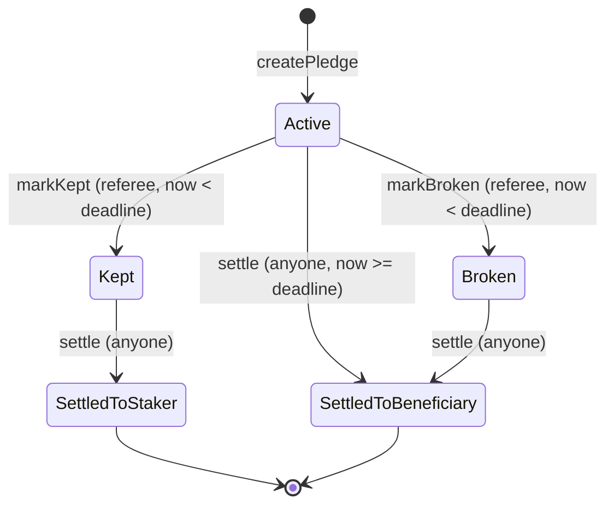

# SatStake

Lock Bitcoin against a promise. Keep it and you get your sats back. Miss it and they go to someone else.

Live on Arc mainnet: https://vasqq.github.io/satstake/

## Contracts (Arc mainnet, chain 5042)

| | Address | Links |
|---|---|---|
| SatStake | [`0xEbcda489EB528c573E9a190eB8EfE63b44d9204e`](https://explorer.arc.io/address/0xEbcda489EB528c573E9a190eB8EfE63b44d9204e) | [Sourcify](https://repo.sourcify.dev/5042/0xEbcda489EB528c573E9a190eB8EfE63b44d9204e) (exact match on creation and runtime), [explorer contract tab](https://explorer.arc.io/address/0xEbcda489EB528c573E9a190eB8EfE63b44d9204e?tab=contract) |
| USDC | `0x3600000000000000000000000000000000000000` | Gas and stake token |
| cirBTC | `0x171A4217b86A807A64eB94757Db6849fb4bDbAA0` | Stake token |

## What it is

A single smart contract on Arc and a static web page. A staker locks cirBTC or USDC against a written promise, names a referee who judges it, and names a beneficiary who receives the stake if the promise is broken. The contract settles the outcome by fixed rules.

## How it works

1. On the New promise page (`#/create`), the staker writes the promise, picks a deadline, and locks the stake. The button says Sign it. After creation confirms, the page shows the pledge number and a link anyone can open without a wallet.
2. Before the deadline, the referee marks the promise kept or broken, once. The pledge page offers Kept and Broken.
3. Anyone can settle. The button says Send payout. Kept returns the stake to the staker. Broken sends it to the beneficiary. If the deadline passes with no verdict, the promise counts as broken.

The UI can show Active pledges past their deadline as Expired. Settling one pays the beneficiary.

Once a pledge exists, funds move only to the staker or the beneficiary, and only through these rules. SatStake has no owner, admin, fee, pause, upgrade, or sweep. The operator cannot change pledges after deployment. Circle can still pause tokens or blocklist addresses; see the trust model.

## Why Arc

- cirBTC is Circle's 1:1 BTC-backed token, available on Arc.
- Gas is paid in USDC at a 20 gwei floor, so a small stake is economical and the staker needs no second token.
- Deterministic finality means a settlement is final when it lands.

SatStake uses cirBTC as the stake, USDC as gas so a $5 promise costs cents to make, and Arc's deterministic finality so a forfeit is final the moment it lands.

## Trust model and limitations

> [!IMPORTANT]
> SatStake never claims that no one can freeze the funds. The token issuer (Circle) can pause a token or blocklist an address, and SatStake says so.

- The referee is trusted by the staker. A dishonest referee can mark a kept promise broken. The staker chooses the referee; SatStake prevents only the structural conflicts (the referee cannot be the staker or the beneficiary).
- The token issuer (Circle) can pause a token or blocklist an address. While paused, pledges in that token cannot be created or settled. A blocklisted recipient cannot receive; that pledge's funds stay locked until the block is lifted.
- Tokens sent directly to the contract, outside `createPledge`, are unrecoverable, because no sweep function exists.
- A beneficiary address that nobody controls makes a broken pledge's stake unrecoverable. The page warns the staker.
- SatStake is tested, not formally verified, and not audited.

## Traceability

The spec chain, test-first evidence, and CI trace checks are in the repo. [docs/TRACE_MATRIX.md](docs/TRACE_MATRIX.md) maps requirements to code; [docs/evidence/tdd-log.md](docs/evidence/tdd-log.md) records red-then-green runs; [docs/ACCEPTANCE.md](docs/ACCEPTANCE.md) lists the 55 user journeys and their verification status.
