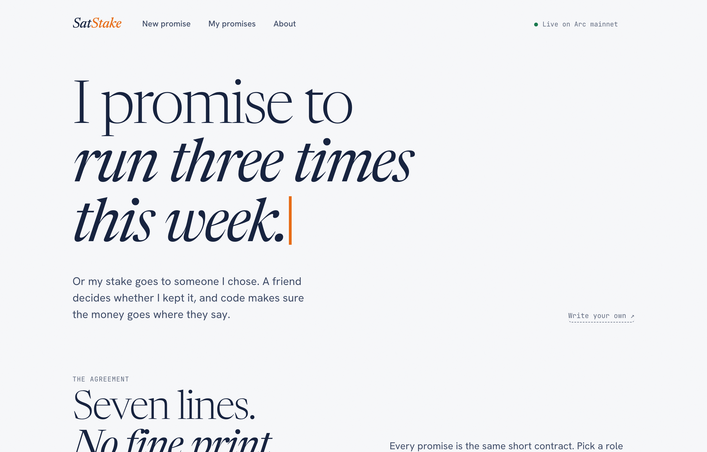
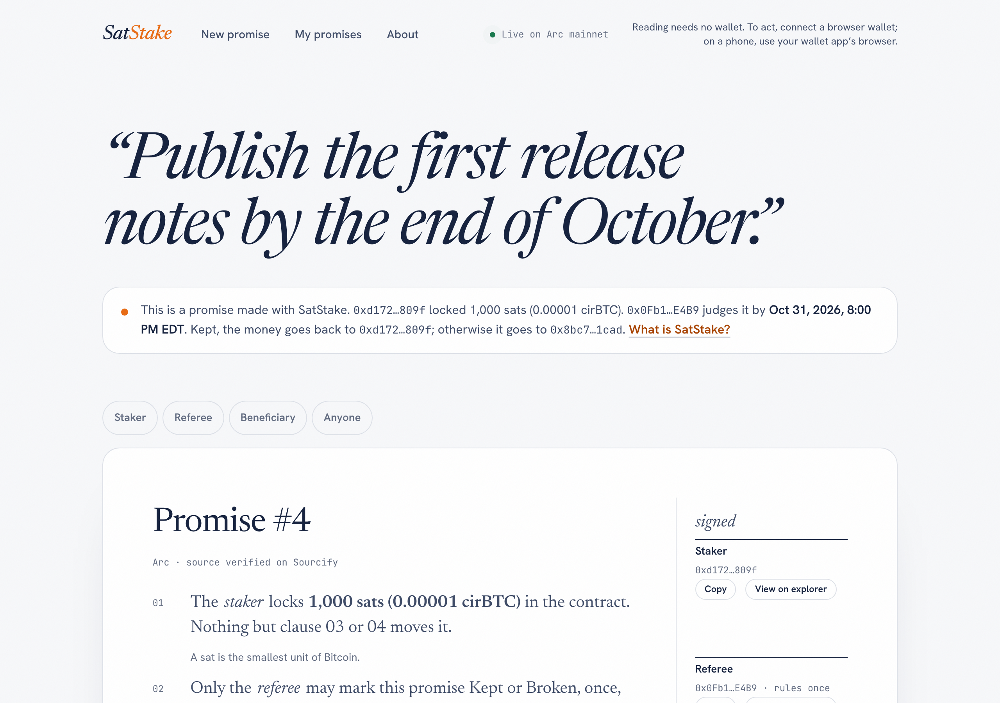
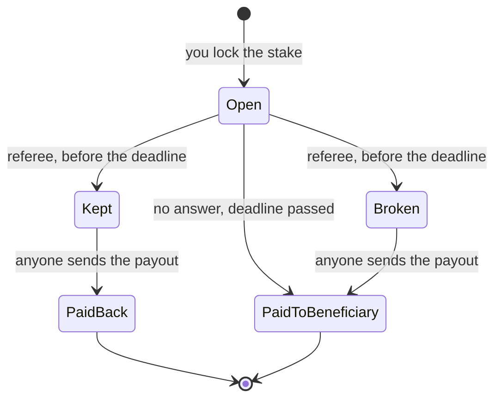

<picture>
  <source media="(prefers-color-scheme: dark)" srcset="brand/lockup-horizontal-reversed.svg">
  
</picture>

### Lock Bitcoin against a promise. Keep it and you get your sats back. Miss it and they go to someone else.

SatStake puts real money behind something you said you'd do. A friend you pick judges it, and a contract on **Arc mainnet** sends the stake back to you or on to the person you named.

[Live site](https://vasqq.github.io/satstake/) · [Try it](#try-it) · [How it works](#how-it-works) · [Onchain proof](#onchain-proof) · [Why Arc](#why-arc) · [What it can't do](#what-it-cant-do)

 

The live site on Arc mainnet.

> **I promise to run three times this week.**
>
> Alex locks $20 in USDC, picks Sunday 9 pm as the deadline, names Sam as the referee and Jo as the person who gets the money if Alex misses. Before Sunday 9 pm, Sam marks it kept or broken. Kept, and the $20 goes back to Alex. Broken, or no answer at all, and it goes to Jo.

## Who it's for

Commitment contracts like stickK work because losing money hurts more than breaking a promise to yourself. The catch is that the service holds your money, decides whether you kept your word, and pays out on its own schedule. You end up trusting the platform more than the promise.

SatStake gives those jobs to a short contract and a friend. The contract holds the stake, your friend makes the call, and the payout follows rules nobody can change afterwards, me included. People use it for habits, friendly bets, work deadlines, or a donation to a cause if they miss.

## Try it

Live site: **[vasqq.github.io/satstake](https://vasqq.github.io/satstake/)**

### In one minute, no wallet

Reading a promise needs no wallet. These four are live on mainnet, one for each ending:

| Promise | What happened |
| --- | --- |
| [#1 Walk for thirty minutes every day this week.](https://vasqq.github.io/satstake/#/p/1) | Marked kept, 1,000 sats paid back to the staker |
| [#2 Send the draft to the editor before the deadline.](https://vasqq.github.io/satstake/#/p/2) | No answer by the deadline, 1 USDC paid to the beneficiary |
| [#3 Cook dinner at home on all five weekdays.](https://vasqq.github.io/satstake/#/p/3) | Marked broken, 1 USDC paid to the beneficiary |
| [#4 Publish the first release notes by the end of October.](https://vasqq.github.io/satstake/#/p/4) | Open, 1,000 sats locked until Oct 31 |

### In five minutes, with a wallet

You need a browser wallet with Arc mainnet added and about $1 of USDC on Arc. Network fees are paid in USDC and cost cents. A promise has three different addresses: yours, the referee's, and the one that gets the stake if you miss, so have three accounts ready if you want to play every part yourself.

1. Open **New promise**, write the promise, choose USDC or cirBTC and an amount, pick a deadline, and paste the referee's and the beneficiary's addresses.
2. Press **Sign it** and confirm the approval and the creation in your wallet. The page gives you the promise's number and a link.
3. Open the link with the referee's account and press **Kept** or **Broken** before the deadline. Broken asks you to confirm first.
4. Press **Send payout**. Anyone can do this, and the money can only go where the rules say.

> [!CAUTION]
> This is mainnet with real money, and the contract is unaudited. A promise can't be cancelled or changed once it's made, and every promise is public. Use small amounts.

Promise #4: anyone with the link can read the stake, the people and the deadline.

## How it works

1. **Promise and lock.** You write the promise, pick a deadline and a referee, name who gets the stake if you miss, and lock USDC or cirBTC in the contract.
2. **Judge.** Before the deadline, the referee marks it kept or broken. They can answer once, and the stake never passes through them.
3. **Pay out.** Anyone can then send the stake where the rules say.

| Kept | Broken | No answer by the deadline |
| --- | --- | --- |
| Back to you | To the person you named | To the person you named |

Silence counts as broken, so pick a referee who will answer in time.

## Onchain proof

| Contract on Arc mainnet (chain 5042) | Address |
| --- | --- |
| SatStake | [`0xEbcda489EB528c573E9a190eB8EfE63b44d9204e`](https://explorer.arc.io/address/0xEbcda489EB528c573E9a190eB8EfE63b44d9204e), source verified on [Sourcify](https://repo.sourcify.dev/5042/0xEbcda489EB528c573E9a190eB8EfE63b44d9204e) and the [explorer](https://explorer.arc.io/address/0xEbcda489EB528c573E9a190eB8EfE63b44d9204e?tab=contract) |
| USDC (stake and gas) | `0x3600000000000000000000000000000000000000` |
| cirBTC (stake) | `0x171A4217b86A807A64eB94757Db6849fb4bDbAA0` |

The four example promises, transaction by transaction:

| Promise | Stake | Created | Verdict | Payout |
| --- | --- | --- | --- | --- |
| #1 | 1,000 sats | [`0x42ed…9a14`](https://explorer.arc.io/tx/0x42edc1c76c7adf506b658e0957cd80a56efaada6cd6569801912c512fec09a14) | [Kept](https://explorer.arc.io/tx/0xaa3027055a9d447b2ca2385dd481a93c611512e185efe1edd06dc48202b51e84) | [To the staker](https://explorer.arc.io/tx/0x12535aff6aa71a7de574dfcc5d5e8a833fb2d3975024c01b994e8a61929bc4ee) |
| #2 | 1 USDC | [`0x2e8a…ffa5`](https://explorer.arc.io/tx/0x2e8a964e767428d8067c02ac592ac20394555b9417ff82c5791ff9ee6a64ffa5) | None by the deadline | [To the beneficiary](https://explorer.arc.io/tx/0xc88bc0fefadea76d408c8c19123a6385c214f42dfe0eef9babe00745079d7212) |
| #3 | 1 USDC | [`0x052f…0cdd`](https://explorer.arc.io/tx/0x052f103e764161ac8a28c83f8a7185c1acc75c1c076e236f2d86f9b89d670cdd) | [Broken](https://explorer.arc.io/tx/0xb4ef0202dc4aeb9f941aacc9f37dcedb2ca2b7e0ce201ff6c8cdb23af48365b2) | [To the beneficiary](https://explorer.arc.io/tx/0x195905df3227ce06e77bc9832b20e8c067ae10170336b8cf50d255bad06564d1) |
| #4 | 1,000 sats | [`0xe067…a2e5`](https://explorer.arc.io/tx/0xe0679b5561d3a316b2a321bc6a33f6bb8e620b6326ab7ecfa50a35c3e71fa2e5) | Open until Oct 31 | |

I made these four myself to show each ending; they aren't users.

## Why Arc

- The stake can be cirBTC, Circle's 1:1 Bitcoin-backed token on Arc, so amounts show in sats.
- Gas is paid in USDC, so a $5 promise costs cents to make and you don't need a second token.
- Arc's finality is deterministic, so a forfeit is final the moment it lands.

## What it can't do

> [!IMPORTANT]
> Circle, which issues USDC and cirBTC, can pause a token or block an address. While a token is paused, promises in it can't be made or paid out, and a blocked recipient can't receive until the block is lifted.

- Your referee is someone you trust, and could judge you unfairly. The contract only stops the obvious conflicts: the referee can't be you or the beneficiary.
- The contract has no owner, admin, fee, pause, upgrade or withdrawal function. That also means tokens sent to it directly, outside a promise, can't be recovered, and a beneficiary address nobody controls loses a broken promise's stake for good. The site warns you about the second case.
- It's tested, not audited.

## Under the hood

One Solidity contract ([`src/SatStake.sol`](src/SatStake.sol)) and a static React site ([`app/`](app/)) on GitHub Pages. There's no backend and no indexer: the promise text and each address's list of promises live in the contract, so the site reads everything straight from Arc. The site only ever asks your wallet to connect, switch network and send the transactions a promise needs; it never asks you to sign a message.

The contract is covered by unit, fuzz and invariant tests at 100% coverage, and CI runs Slither on every push.

## What's next

- An independent audit before larger stakes.
- Reminders for the referee as the deadline gets close, so fewer promises fail by silence.
- More than one referee on a promise.

## Built with

| Used for | Project | License |
| --- | --- | --- |
| Contract | Solidity 0.8.28, [OpenZeppelin](https://www.openzeppelin.com/contracts) `SafeERC20` and `ReentrancyGuard` | MIT |
| Tests and deployment | [Foundry](https://getfoundry.sh) | MIT or Apache-2.0 |
| Site | React 19, Vite, TypeScript | MIT |
| Wallet and chain reads | [wagmi](https://wagmi.sh), [viem](https://viem.sh), TanStack Query | MIT |
| Fonts | Newsreader, Hanken Grotesk, JetBrains Mono, self-hosted | OFL-1.1 |
| Verification | [Sourcify](https://sourcify.dev) | |

Built by Liam Pereira ([@Vasqq](https://github.com/Vasqq)) for Arc Microgrants. The logo and brand files in [`brand/`](brand/) were made for this project. I built SatStake with help from Claude Code, and every mainnet transaction above was checked onchain.

 

 
SatStake · live on Arc mainnet · unaudited, use small amounts

